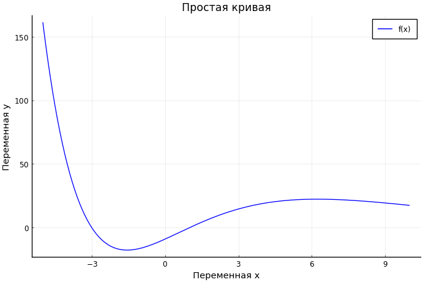
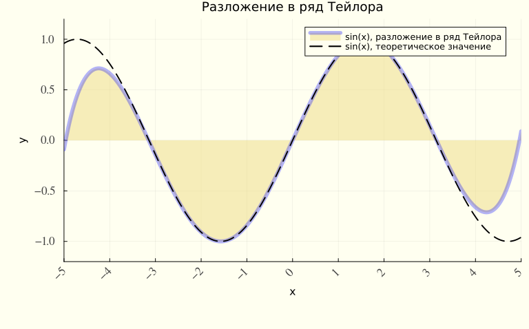
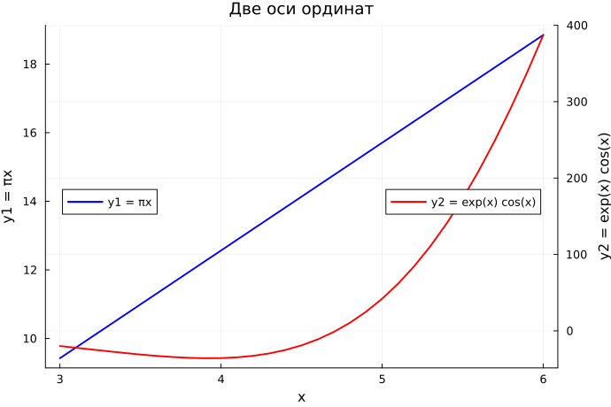
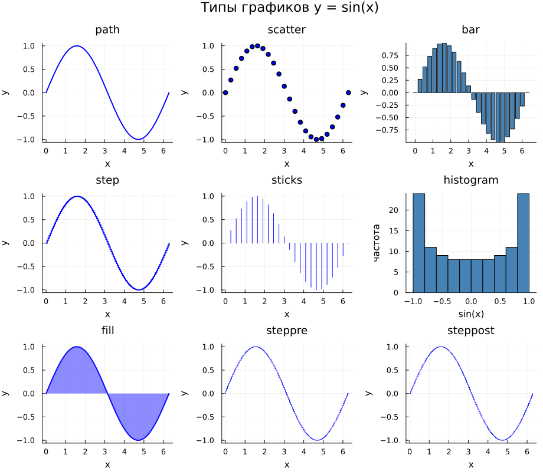
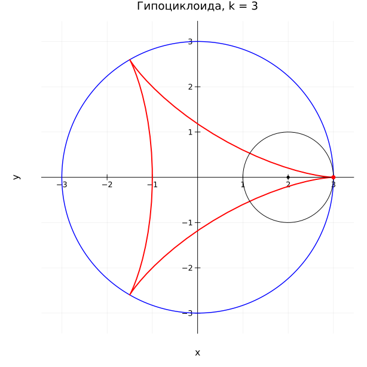
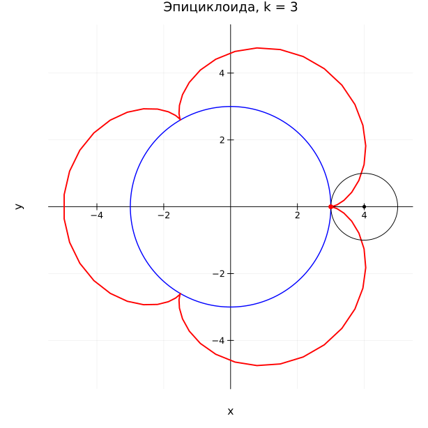

# Информация

## Докладчик

:::::::::::::: {.columns align=center}
::: {.column width="70%"}

  * Беспутин Глеб Антонович
  * Студент
  * Российский университет дружбы народов им. П. Лумумбы
  * [glebb2005@mail.ru](mailto:glebb2005@mail.ru)

:::
::: {.column width="30%"}

:::
::::::::::::::

# Вводная часть

## Актуальность

- График — основной способ увидеть функцию, выборку и погрешность
- В Julia один интерфейс `Plots` закрывает линии, точки, поверхности и анимацию
- Бэкенд меняется одной командой: `gr()`, `pyplot()`, `plotly()`, `unicodeplots()`
- Две оси и макет окон нужны, когда ряды не помещаются в один масштаб

## Объект и предмет исследования

- **Объект:** построение графиков на языке Julia
- **Предмет:** пакет `Plots`, оформление серий, поверхности, линии уровня, погрешности и анимация циклоид

## Цели и задачи

**Цель:** освоить синтаксис Julia для построения графиков.

**Задачи:**

1. Повторить примеры раздела 5.2 и подписать оси, легенду и заголовок
2. Собрать типы графиков и стили линий для $y = \sin x$
3. Построить $y = \pi x^2 \ln x$ и четыре окна для $y = x^3 - 3x$
4. Сравнить одну и две оси для рядов разного размаха
5. Собрать анимации синусоиды, гипоциклоиды и эпициклоиды

## Материалы и методы

- Язык Julia 1.12.5
- `Plots` — линии, точки, поверхности, `layout`, `@animate`
- Бэкенды GR, PyPlot, plotly, UnicodePlots
- `Distributions` — нормальная выборка и гистограмма
- Зерно `Random.seed!(42)`
- Рисунки пишутся `savefig` во время прогона скрипта

# Содержание исследования

## Одна кривая, четыре бэкенда

- $f(x) = (3x^2 + 6x - 9)e^{-0{,}3x}$ на $[-5, 10]$
- GR, PyPlot и plotly дают одну и ту же кривую
- UnicodePlots рисует профиль символами: от около $-23$ до около $167$
- Русские подписи проходят и в GR, и в PyPlot

## Ряд Тейлора

- Пять слагаемых, степень 9
- Рядом с $\sin x$ на $[-\pi, \pi]$, расходится к краям $[-2\pi, 2\pi]$
- `plot!` кладёт вторую серию на те же оси
- Заливка, шаг делений, поворот подписей и цвет фона — атрибуты `plot`

## Масштаб и две оси

- Полином 5-й степени: $c = A \setminus y$
- Невязка на шуме $4000\varepsilon$ остаётся порядка нормы шума
- $y_1 = \pi x$ и $y_2 = e^{x}\cos x$: размахи относятся как $44{,}9$
- На общей оси прямая $\pi x$ почти горизонтальна
- `twinx()` возвращает каждой кривой свою шкалу

# Результаты

## Кривая и ряд

{width=70%}

Подписи PyPlot на той же $f(x)$, что рисует GR.

## Оформленный синус

{width=78%}

Синяя заливка — ряд, пунктир — $\sin x$. Файл продублирован как `taylor.png` и `taylor.pdf`.

## Две оси

{width=78%}

Слева шкала $\pi x$ от 9 до 19, справа шкала $e^{x}\cos x$ до 387.

## Типы графика синуса

{width=88%}

Девять представлений одной функции в одном окне: линия, точки, столбцы, ступеньки, палочки, гистограмма значений, заливка.

## Циклоиды

:::::::::::::: {.columns}
::: {.column width="50%"}

Гипоциклоида, $k = 3$

:::
::: {.column width="50%"}

Эпициклоида, $k = 3$

:::
::::::::::::::

Для $k = 5/2$ и $k = 7/3$ параметр идёт на два и на три оборота, иначе кривая не замыкается. Кадры собраны в gif.

## Что ещё посчитано

- Четыре окна $y = x^3 - 3x$ записаны в `figure_besputin.png`. В узлах $y = (-2, 2, 0, -2, 2)$
- $y = \pi x^2 \ln x$ на $[0{,}2,\, 5]$ идёт от $-0{,}58$ до $126$. Рамка зелёная, линия красная, шрифт Times
- Остывание $T = 22 + 65 e^{-0{,}15 t}$ с усами $\sigma = 0{,}8$ °C
- Смесь трёх нормальных распределений, 1834 значения, на гистограмме три горба
- Доли высоты $0{,}20 + 0{,}30 + 0{,}40 + 0{,}15 = 1{,}05$ поделены на $1{,}05$: эта версия `Plots` требует сумму 1

## Ключевые выводы

1. Бэкенд меняется без переписывания серии
2. Атрибуты `plot` закрывают подписи, стиль линии, заливку и сетку делений
3. Общая ось прячет ряд, если размахи отличаются в десятки раз
4. `quiver!` и `contour` показывают градиент и линии уровня
5. `@animate` собирает синусоиду и циклоиды; для $k = p/q$ нужно $q$ оборотов
6. Погрешность $1{,}96\,\sigma/\sqrt{n}$ рисуется и усами, и лентой

# Заключение

## Итоги

- Повторены примеры раздела 5.2: от линии до векторного поля и gif
- Девять типов графика $\sin x$ и пять стилей линии собраны в одном окне каждое
- Две оси отделяют $\pi x$ от $e^{x}\cos x$
- Гипоциклоида и эпициклоида построены для $k = 3$, $4$, $5/2$, $7/3$
- Исходный файл — literate-скрипт. Из него командой `tangle.jl` собраны `.jl`, `.qmd` и блокнот

## Перспективы

- Подписи в TeX через `LaTeXStrings` на бэкенде, который их показывает
- Статистические геомы `StatsPlots`: скрипка, коробка, регрессия
- Более длинные анимации с фиксированной цветовой шкалой между кадрами
