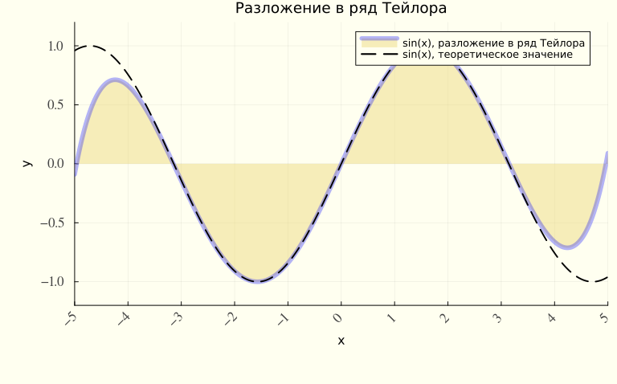
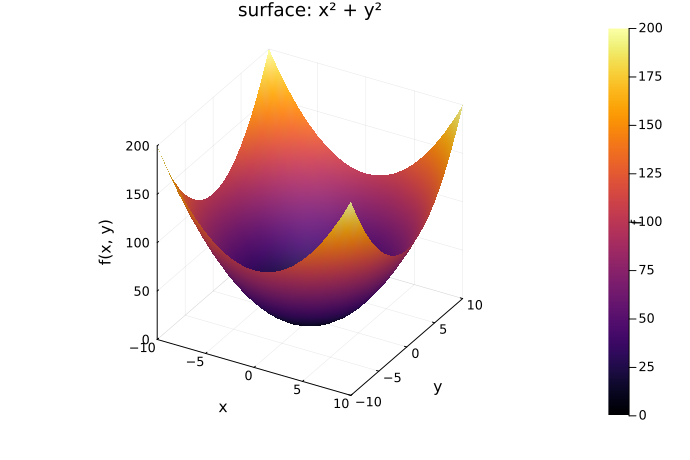
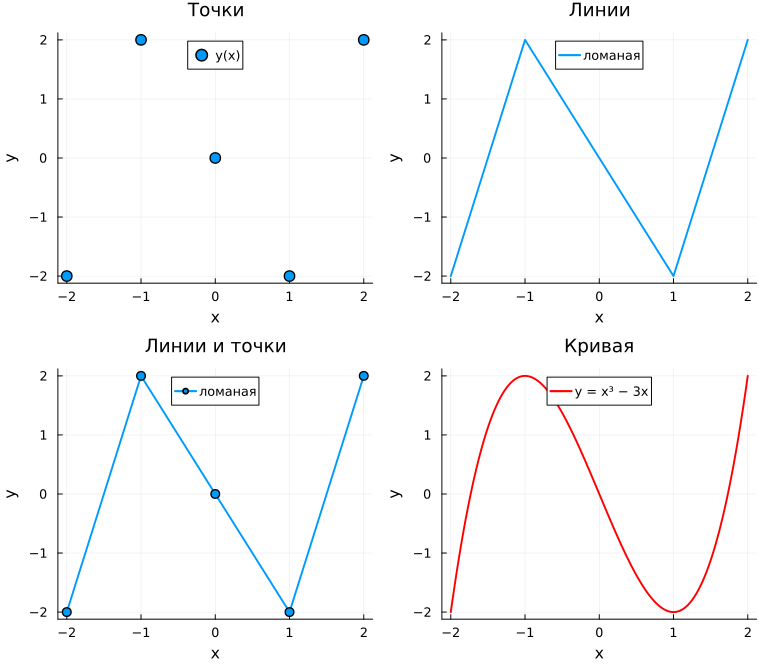
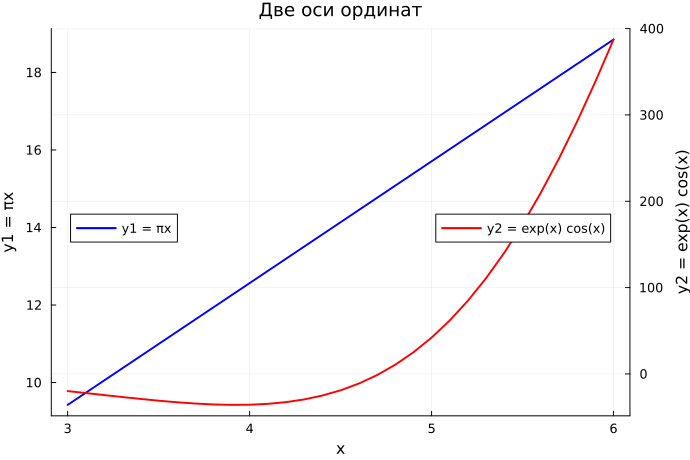

---
## Author
author:
  name: Беспутин Глеб Антонович
  email: glebb2005@mail.ru
  affiliation:
    - name: Российский университет дружбы народов
      country: Российская Федерация
      city: Москва
      address: ул. Миклухо-Маклая, д. 6

## Title
title: "Лабораторная работа №5 Построение графиков"
subtitle: "Компьютерный практикум по статистическому анализу данных"
license: "CC BY"
---

# Цель работы

Освоить синтаксис Julia для построения графиков: бэкенды `Plots`, оформление осей и линий, точечные и трёхмерные серии, аппроксимацию, две оси ординат, полярные и параметрические кривые, поверхности, линии уровня, векторные поля, анимацию, погрешности и гистограммы.

# Задание

1. Повторить примеры раздела 5.2 и дополнить графики подписями осей, легендой и названием.
2. Выполнить задания раздела 5.4:
   - типы графиков и стили линий для $y = \sin x$ на $[0, 2\pi]$;
   - график $y = \pi x^2 \ln x$ с заданным цветом рамки, шрифтом и частотой делений;
   - четыре окна для $y = x^3 - 3x$ в файле `figure_besputin.png`;
   - $y_1 = \pi x$ и $y_2 = e^{x}\cos x$ на одной оси и на двух осях;
   - экспериментальный ряд с погрешностью;
   - плоский и пространственный точечные графики;
   - анимация синусоиды;
   - анимированные гипоциклоида и эпициклоида для двух целых и двух рациональных $k$.

Случайные выборки порождаются с зерном `Random.seed!(42)`, поэтому прогон повторяется. Рисунки записывает `savefig` в каталог `report/image` в том виде, в каком они строятся при выполнении скрипта.

# Теоретическое введение

## Пакет Plots и бэкенды

`Plots` задаёт один набор команд, а рисует выбранная библиотека. Переключение — вызов `gr()`, `pyplot()`, `plotly()` или `unicodeplots()`. В этой работе статичные файлы png и pdf пишет GR, русские подписи на том же графике проверяются через PyPlot, интерактивная копия сохраняется бэкендом plotly (пакеты `PlotlyBase` и `PlotlyKaleido`), текстовая копия — UnicodePlots.

Функция одной переменной задаётся поэлементно. Для

$$
f(x) = (3x^2 + 6x - 9)\, e^{-0{,}3x}
$$

массив $x$ и массив $y = f(x)$ передаются в `plot`. Подписи — атрибуты `title`, `xlabel`, `ylabel`, `label`.

## Ряд Тейлора и оформление

Частичная сумма ряда синусов до степени 9:

$$
\sin x \approx \sum_{n=0}^{4} \frac{(-1)^n x^{2n+1}}{(2n+1)!}.
$$

`plot!` добавляет вторую серию на текущие оси. Цвет, прозрачность, толщина и стиль собираются в кортеж `line`. `fillrange` закрашивает область до заданного уровня, `xticks` и `yticks` задают частоту делений, `xrotation` поворачивает подписи оси абсцисс.

## Точки, аппроксимация, две оси

`scatter` и `seriestype = :scatter` рисуют маркеры. Вектор `markersize` кодирует третье значение размером точки. В трёхмерном случае в `scatter` передаются три координаты.

Полином степени 5 по точкам $(x_i, y_i)$ ищется из условия минимума суммы квадратов отклонений. Столбцы матрицы $A$ — это $1, x, x^2, \ldots, x^5$, и коэффициенты равны $c = A \setminus y$. Оператор `\` для прямоугольной матрицы даёт решение наименьших квадратов.

`twinx()` добавляет правую ось ординат. Она нужна, когда размахи двух рядов различаются на порядок: общая ось оставляет мелкий ряд почти горизонтальной полосой.

## Кривые, поверхности, поле

В полярных координатах `proj = :polar`, радиус считается как $r(\theta)$. Параметрическая кривая на плоскости задаётся двумя функциями параметра, в пространстве — тремя массивами. `surface` и `linetype = :wireframe` строят $f(x, y)$. `contour` проводит линии уровня, `fill = true` заливает промежутки между ними.

Градиент $h(x, y) = x^3 - 3x + y^2$ равен $(3x^2 - 3,\, 2y)$. `quiver!` ставит эти векторы на сетку. Деление на 25 удерживает длину стрелки в масштабе рисунка.

## Анимация и циклоиды

`@animate` собирает кадры, `gif` записывает их в один файл. Кадр синусоиды — график на всё более длинном отрезке аргумента.

Гипоциклоида — след точки окружности радиуса $r$, катящейся внутри окружности радиуса $R = kr$:

$$
x = r(k-1)\cos t + r\cos((k-1)t), \quad
y = r(k-1)\sin t - r\sin((k-1)t).
$$

Эпициклоида — та же точка, окружность катится снаружи:

$$
x = r(k+1)\cos t - r\cos((k+1)t), \quad
y = r(k+1)\sin t - r\sin((k+1)t).
$$

Для $k = p/q$ в несократимых целых кривая замыкается за $q$ оборотов, поэтому параметр доводится до $2\pi q$.

## Погрешности и гистограммы

Для среднего $n$ нормальных величин с разбросом $\sigma$ полуширина интервала берётся $1{,}96\,\sigma/\sqrt{n}$. На графике это `yerr`, `xerr` или лента `ribbon`. Асимметричный интервал задаётся парой векторов.

`Distributions` даёт `Normal(μ, σ)` и выборку `rand`. `histogram` строит частоты. Несколько окон в одной фигуре задаёт `layout`: кортеж `(N, M)`, целое число, `grid` с долями высоты или макрос `@layout`.

# Выполнение лабораторной работы

Скрипт `project/scripts/lab05-literate.jl` повторяет раздел 5.2 и решает задания раздела 5.4. Команда `julia --project=. scripts/tangle.jl scripts/lab05-literate.jl` собирает из него чистый скрипт, документ Quarto и блокнот Jupyter Lab. Ниже приведён этот документ: пояснения и листинг.



# Результаты

## Повторение примеров из раздела 5.2

1. Одна кривая $f(x) = (3x^2 + 6x - 9)\, e^{-0{,}3x}$ на $[-5, 10]$ построена бэкендами GR, PyPlot, plotly и UnicodePlots. При $x = -5$ значение около 161, минимум около $-17{,}7$ при $x \approx -1{,}5$.
2. Пять слагаемых ряда Тейлора держатся рядом с $\sin x$ на $[-\pi, \pi]$ и расходятся к краям $[-2\pi, 2\pi]$. На оформленном графике шаг делений по $x$ равен 1, по $y$ равен 0,5, шрифт делений — Times, подписи оси $x$ повёрнуты на 45°.
3. Точечные графики построены с зерном 42. Для десяти точек $y$ равен 0,174; 0,322; 0,259; 0,166; 0,527; 0,483; 0,391; 0,803; 0,722; 0,372.
4. Полином 5-й степени для $e^{1+x} + 4000\varepsilon$ дал коэффициенты $-587{,}66$; $2329{,}56$; $-2518{,}17$; $935{,}64$; $-141{,}44$; $7{,}66$. Норма невязки $125163$, то есть на уровне шума $4000\sqrt{1000}$.
5. `twinx`, полярные и параметрические кривые, поверхности, линии уровня и градиент построены отдельными вызовами `plot`. Доли высоты подграфиков в методичке суммируются в 1,05; эта версия `Plots` принимает только сумму 1, поэтому доли поделены на 1,05.
6. Шесть серий погрешностей, $n = 10$. Полуширины $1{,}96\,\sigma/\sqrt{n}$ равны 0,620; 0,310; 0,155; 0,077; 0,039; 0,019. Смесь трёх нормальных распределений содержит 1834 числа, среднее 32,55.

{#fig-styled width=75%}

{#fig-surf width=60%}

## Задания для самостоятельной работы

1. На $[0, 2\pi]$ в одном окне собраны девять представлений $y = \sin x$: линия, точки, столбцы, ступенька, палочки, гистограмма значений, заливка до нуля, `steppre` и `steppost`.
2. У GR пять стилей линии. Шестая кривая — сплошная с маркерами. Каждая следующая поднята на 0,45.
3. На $[0{,}2,\, 5]$ функция $\pi x^2 \ln x$ меняется от $-0{,}578$ до $126{,}4$. Линия красная, рамка зелёная, шрифт Times, шаг по $x$ равен 0,5, по $y$ — 20.
4. Для $x = (-2, -1, 0, 1, 2)$ значения $y = x^3 - 3x$ равны $(-2, 2, 0, -2, 2)$. Четыре окна сохранены в `figure_besputin.png`.
5. На $x = 3; 3{,}1; \ldots; 6$ размах $y_1 = \pi x$ равен 9,42, размах $y_2 = e^{x}\cos x$ равен 423. Отношение размахов 44,9, поэтому на общей оси прямая почти не видна, а `twinx` возвращает каждой кривой свою шкалу.
6. Остывание задано моделью $T(t) = 22 + 65 e^{-0{,}15 t}$. В нуле измерение 86,7 при модели 87,0, на 10-й минуте 35,8 при модели 36,5, на 20-й — 24,5 при модели 25,2.
7. Построены плоский и пространственный точечные графики и анимация синусоиды на неподвижном окне $[0, 2\pi]$.
8. Гипоциклоида и эпициклоида построены для $k = 3$, $k = 4$, $k = 5/2$ и $k = 7/3$. Для рационального $k = p/q$ параметр делает $q$ оборотов, иначе кривая не замыкается.

{#fig-besputin width=80%}

{#fig-twin width=75%}

# Выводы

1. Один вызов `plot` в `Plots` рисуется бэкендами GR, PyPlot, plotly и UnicodePlots. Русские подписи проходят и в GR, и в PyPlot. plotly дополнительно отдаёт html, UnicodePlots — текстовый график.

2. Частичная сумма ряда Тейлора до степени 9 совпадает с $\sin x$ вблизи нуля и отходит к краям отрезка $[-2\pi, 2\pi]$. Заливка, шаг делений, поворот подписей и цвет фона задаются атрибутами той же команды `plot`.

3. Размер маркера переносит третье число на плоский точечный график. `scatter` с тремя массивами строит точки в пространстве.

4. Коэффициенты полинома 5-й степени считаются оператором `\`. На шуме $4000\varepsilon$ невязка остаётся порядка нормы этого шума: полином повторяет ход экспоненты.

5. Если размахи рядов отличаются в десятки раз, общая ось скрывает меньший ряд. Для $\pi x$ и $e^{x}\cos x$ отношение размахов равно 44,9. `twinx()` возвращает каждому ряду свою шкалу.

6. `contour` и `quiver!` показывают линии уровня и градиент. `@animate` и `gif` собирают поверхность, синусоиду и циклоиды. Для $k = p/q$ параметр нужно вести $q$ оборотов, иначе кривая не замыкается.

7. Усы `yerr` и лента `ribbon` рисуют одну и ту же погрешность $1{,}96\,\sigma/\sqrt{n}$. Смесь трёх нормальных распределений на гистограмме даёт три горба. Сетка окон задаётся `layout`, `grid` и `@layout`. Доли высоты в этой версии `Plots` обязаны давать в сумме 1.

# Список литературы{.unnumbered}

1. Julia Documentation. — URL: https://docs.julialang.org/en/v1/.
2. Plots.jl. — URL: https://docs.juliaplots.org/stable/.
3. Distributions.jl. — URL: https://juliastats.org/Distributions.jl/stable/.
4. Klok H., Nazarathy Y. Statistics with Julia: Fundamentals for Data Science, Machine Learning and Artificial Intelligence. — 2020. — URL: https://statisticswithjulia.org/.
5. Кулябов Д. С. и др. Компьютерный практикум на языке Julia. Лабораторная работа № 5. Построение графиков.
